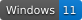
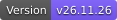
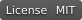
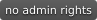
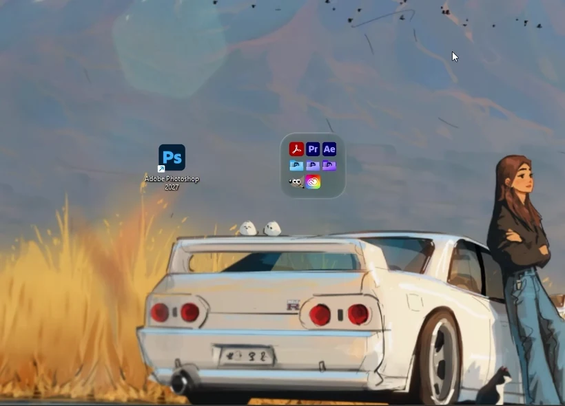
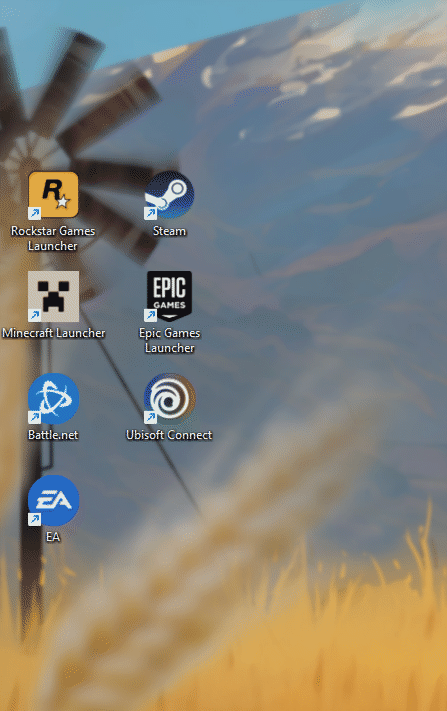

# DesktopBubbles <a href="README.en.md"></a><a href="README.md"></a>

**Phone-style folders for Windows. In the Liquid Glass style of iOS 27.**

<p align="center"> <a href="https://github.com/Hendrik4K/DesktopBubbles/releases/latest"></a> <a href="LICENSE"></a>  <a href="https://github.com/Hendrik4K/DesktopBubbles/actions/workflows/windows.yml"></a></p>

<p align="center"></p>

Folders like on your phone, just for your PC. Pack all your launchers or creative apps into one bubble: a click opens it, you pick the app, and once your mouse leaves, it can close by itself. Liquid Glass, matte or frosted background, intensity, size, name on or off: your choice.

<table>
  <tr>
    <th>Before → After</th>
    <th>Bubbles &amp; settings</th>
  </tr>
  <tr>
    <td width="34%" valign="middle"></td>
    <td width="66%" valign="middle"></td>
  </tr>
</table>

<details>
<summary><b>🚀 Quick start</b></summary>

1. Download the installer from **[Releases](https://github.com/Hendrik4K/DesktopBubbles/releases/latest)** and run it. It installs for your account only, needs no admin rights and ships the .NET runtime. If Windows SmartScreen says "Windows protected your PC": **More info → Run anyway** (the installer is not code-signed).
2. Start **DesktopBubbles** from Windows Search and create a bubble with **New**.
3. Drag shortcuts from your desktop onto the bubble.
4. Click the bubble, pick an app. Done.

**Laid-back type?** Then just hand this prompt to your AI agent (e.g. Claude Code or Codex on your PC). It checks what's already there, fetches the installer, verifies the checksum and asks you before every change.

```text
Help me install DesktopBubbles (github.com/Hendrik4K/DesktopBubbles) on this Windows PC.
Check first and ask me before every change:
1. Is this Windows 11 64-bit? Is DesktopBubbles already installed, or is a portable version running?
2. Download the latest installer (DesktopBubbles-Setup-*.exe) from the GitHub releases, compare its SHA256 with the .sha256 file next to it and only run it after my OK. It needs no admin rights.
3. If an older version is running, tell me to quit it from the tray icon first. My bubbles are kept.
4. Don't move, copy or delete any shortcuts on my desktop; I'll drag them in myself.
5. At the end, tell me how to start DesktopBubbles, create a bubble and drag shortcuts into it.
```

The app then waits in the notification area; a click on the soap-bubble icon opens the settings. **Tray → Quit** quits it completely. Rather not install? Extract the **portable ZIP** from Releases into a writable folder and start `DesktopBubbles.exe`.

The app speaks German and English: switch with the language toggle in the settings.

**Build it yourself (for tinkerers):** Windows 11 x64 and the .NET 8 SDK (or Visual Studio with .NET desktop development). No third-party NuGet dependencies.

```powershell
.\Build.ps1 -InstallSdk -OutputName DesktopBubbles-win-x64
.\Test-Windows.ps1 -Executable .\artifacts\DesktopBubbles-win-x64\DesktopBubbles.exe
.\tools\Get-InnoSetup.ps1
.\tools\Build-Installer.ps1 -Payload .\artifacts\DesktopBubbles-win-x64
```

`Build.ps1` builds the portable output, runs the core checks and packs the ZIP with SHA-256 checksums. `Test-Windows.ps1` checks the real app on an interactive desktop with its own test data. More in [Architecture](docs/ARCHITECTURE.md), [Developer rules](docs/DEVELOPMENT.md) and [Release](docs/RELEASE.md) (German).

</details>

<details>
<summary><b>💡 What it does</b></summary>

- **Works like on your phone**<br>Click the bubble, pick the app, done. Group shortcuts, programs, folders, web links and Store apps by gaming, work, creative or whatever you like. The programs themselves stay where they are.
- **Styles: Liquid Glass, Matte, Clear or Frosted**<br>Liquid Glass bends the real background at the edges like a lens, with adjustable strength. Frosted blurs it softly. The icons always stay sharp.
- **Customizable folders**<br>Hold until everything wiggles, then swap icons. Folders spring open out of the preview. A color per bubble or one for all (color wheel, HEX, eyedropper), size and transparency up to 100 percent, preview 1:3 or 1:1, name on or off, light, dark or like Windows.
- **Automation**<br>Leave the folder and after a set number of seconds it shuts behind you like a door. If a program update puts its shortcut back on the desktop, it moves back into its bubble by itself.
- **Drag & drop**<br>Into a bubble, out onto the desktop, over into another bubble.
- **Language**<br>German and English, switched with one click in the settings.
- **Unobtrusive**<br>No account, no telemetry, no admin rights, quiet in the notification area. Curious what the app costs? Start the measurement bar for CPU and RAM.

<ins>Why it exists:</ins> My desktop was full of launchers, and there was no simple phone-style folder solution for Windows. So I built one and am sharing it with everyone.

</details>

<details>
<summary><b>📷 More pictures</b></summary>

<!-- Room for more GIFs: 1:3 ↔ 1:1, color picker with eyedropper, language toggle, measurement bar -->
<p align="center"></p>

</details>

<details>
<summary><b>🖱️ How to use</b></summary>

| Action | How |
| --- | --- |
| Open / close | Click the preview; Esc or a click outside closes |
| Move a bubble | Drag the closed preview |
| Add items | Drag & drop, or right-click the preview → Add |
| Swap places | Hold an icon ½ second until everything wiggles, then drop it on another icon |
| Into another bubble | Drag straight onto the other bubble without holding first |
| Back to the desktop | Drag the icon out, or right-click → Back to desktop |
| Remove from the group only | Right-click the icon → Remove from group (works with a broken target too) |
| Find a bubble | Right-click the group row → Find on desktop |
| Settings | Gear at the bottom right; click it again or use the back arrow to return |
| Keyboard | Tab / Shift+Tab, Enter / Space; Ctrl+N creates a bubble |

Personal desktop shortcuts are first copied and verified, then the app removes the original from the desktop. To only copy, turn off **Settings → Remove desktop originals after adopting them**. Programs, files and folders are never moved. When returning an item, the new shortcut appears on the desktop first, only then does the entry disappear. Details: [Shortcuts and returning them](docs/SHORTCUTS.md) (German).

</details>

<details>
<summary><b>🧰 Requirements, data and updates</b></summary>

**Requirements:** Windows 11 x64. The installer brings everything the app needs.

**Your data** lives in `%LOCALAPPDATA%\Programs\DesktopBubbles\data` for the installed version. **Settings → Open data folder** always shows the folder actually in use. Under **Settings → Data & tools** you can export and import backups (`.bubbles`), put all shortcuts back on the desktop and save a local diagnostics report.

**Updates:** Quit the running app from the tray, then run the new installer. Your bubbles are kept; the installer backs them up first. There is no automatic update install, but the tray menu can check for new versions.

**Uninstalling:** First run **Settings → Put shortcuts back on the desktop**, otherwise adopted shortcuts only live in the data folder. Uninstalling leaves your data in place.

<details>
<summary>🆘 <b>Switching over:</b> portable version, custom data folders and autostart</summary>

The portable version stores its data next to the EXE in `data\` (via `portable.flag`). If that folder is not writable, e.g. under Program Files, it falls back to `%LOCALAPPDATA%\DesktopBubbles\profiles\<id>`. Custom locations work with `--data-dir "D:\My folder"`; `--background` starts without the settings window.

Preview, portable and installed versions can use different data folders, which are never merged automatically. When switching, take over the folder with your newest bubbles completely, or export first and import afterwards. Then turn on **Start with Windows** in exactly the version you want to keep. More: [Switching safely](docs/STARTUP.md), [Installer and data retention](docs/INSTALLER.md) (German).

</details>

</details>

<details>
<summary><b>⚡ Tech and security</b></summary>

**How it works**

- C# with WPF and Win32, no browser runtime. The bubbles are small windows of their own, owned by the desktop, not Explorer icons. No hooks, no Explorer patches, nothing that sticks on top of everything.
- **Glass effects:** For Liquid Glass and frosted glass, the app captures a small area of the screen behind the folder when it opens and processes it in memory. The spot under its own preview is filled from the desktop picture Windows renders without the bubbles. That way the preview stays visible in screen recordings such as OBS, too.
- **Measurement bar:** measures only the app's own process, and only while you let it run. Method: [Performance](docs/PERFORMANCE.md) (German).

**Security and privacy**

- No account, no telemetry, no automatic uploads. Network access only happens when you open a web link or check for updates in the tray.
- Screen areas for the glass effects stay in memory. They are never saved or sent anywhere.
- Installs only into your own user profile, without admin rights. Autostart only on your click, via `HKCU\…\Run`.
- Shortcuts are copied and verified before an original disappears. Name clashes get a new name; on errors everything stays as it was.
- Diagnostics reports stay local. If you attach one to an issue, check it for private paths first.

**Known limits**

- Normal windows may cover the bubbles; the desktop attachment is still considered experimental.
- Multiple monitors with mixed scaling, virtual desktops, cloud and network paths and UAC edge cases are not yet fully tested. Reports are welcome under [Issues](https://github.com/Hendrik4K/DesktopBubbles/issues).

</details>

<details>
<summary><b>🖼️ Pictures and trademarks</b></summary>

The source code is under the [MIT license](LICENSE). The soap-bubble logo, the demo GIFs and the desktop captures are **not** part of it. App icons in the pictures come from the Windows shell; Steam, Epic Games, Adobe, Apple, iOS and other names are trademarks of their owners. DesktopBubbles is a private hobby project and not affiliated with any of these companies. The portable output includes the license notices of its .NET runtime. [Branding](src/DesktopBubbles/Assets/README.md), [Changes](CHANGELOG.md) (German).

</details>
