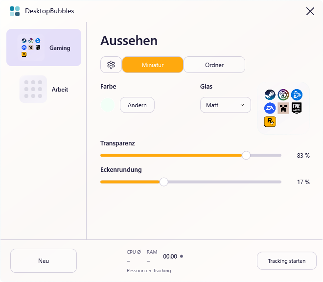

# DesktopBubbles · 1.4.1

Native App-Ordner für den vorhandenen Windows-Desktop. Mini-Bubble anklicken, Programm auswählen. C# / WPF / Win32 ohne Browser-Runtime, Shell-Austausch oder Administratorrechte.

[Download für Windows 11 x64](https://github.com/Hendrik4K/DesktopBubbles/releases/latest) · [Änderungen](CHANGELOG.md) · [MIT-Lizenz](LICENSE)

**Desktop-Anbindung experimentell.** Lokal auf Windows **10.0.26300.0**, x64, .NET **8.0.32** gebaut und geprüft. Weitere Hardwarekonfigurationen sind noch nicht abgenommen. [Prüfstand](docs/TESTS.md), [Release-Vorbereitung](docs/RELEASE.md).

## Neu in 1.4.1

Das Symbolmenü enthält nur **Starten** und **Aus Gruppe entfernen**. Entfernen bringt eine unabhängige, geprüfte Verknüpfung zurück auf den Desktop. Herausziehen per Drag & Drop bleibt ebenfalls verfügbar. Programme werden dabei nicht verschoben; Dateinamenkonflikte erhalten einen neuen Namen.

## Darstellung seit 1.4.0

- **Miniatur** heißt die geschlossene Desktop-Bubble; **Ordner** das geöffnete App-Raster. Das Zahnrad enthält weiterhin die Einstellungen der Verwaltung.
- Unter **Miniatur** gibt es eine gemeinsame Farbe für beide Ansichten. Direkt rechts daneben sitzt die einzige kompakte Glaswahl (Klar/Matt), danach die Vorschau. Die gemeinsame **Eckenrundung** verwendet denselben Anteil der kürzeren Kante und wirkt dadurch bei beiden Größen proportional gleich.
- Transparenz bleibt **getrennt** für Miniatur und Ordner einstellbar, jeweils bis **100 %**. Dann verschwinden Fläche und Rahmen, während Icons sichtbar bleiben. Freie transparente Pixel geben die Maus an den Desktop weiter.
- Unter **Ordner** bleiben Transparenz und Größe. Die Vorschau wächst direkt mit dem Größenregler, zeigt die ausgewählten App-Symbole im festen Maßstab **1:3** und daneben die tatsächlichen nominellen Abmessungen bei 100 % Windows-Skalierung.
- **Tracking starten** aktiviert CPU-Durchschnitt, aktuellen RAM, Verlauf und aktive Dauer. **Tracking stoppen** beendet den Timer und hält die letzten Werte fest. Ein erneuter Start beginnt eine neue Messung. Standardmäßig läuft keine Ressourcenmessung.
- **97 Kernprüfungen und 92 native Windows-Prüfungen bestanden.** Physische Explorer-Mausbedienung und weitere Hardwarefälle bleiben manuell abzunehmen.



## Starten und aktualisieren

Die lokale Ausgabe liegt unter `artifacts/DesktopBubbles-win-x64-v1.4.1`. Alte Ausgabe zuerst **im Tray → Beenden** schließen, dann dort `DesktopBubbles.exe` starten. Das X schließt nur die Verwaltung; für die Desktop-Bubbles läuft die App weiter.

Das portable ZIP vollständig in einen beschreibbaren Ordner entpacken; .NET ist enthalten. Release-ZIPs enthalten keine Benutzerdaten. Beim Upgrade den vollständigen bisherigen `data`-Ordner übernehmen oder eine `.bubbles`-Sicherung importieren. Der lokal vorbereitete Ordner kann bereits eine Datenkopie enthalten. Schema 1/2/3/4 migriert zu **Schema 5**; diesen Datenordner anschließend nicht mit älteren Ausgaben öffnen. Alte Einträge werden beim Upgrade nicht automatisch vom Desktop verschoben.

1. **Neu** wählen und Gruppe benennen.
2. Verknüpfungen auf die Mini-Bubble, ins geöffnete Raster oder auf die Gruppenzeile ziehen.
3. Mini-Bubble auf dem Desktop anklicken, anschließend das gewünschte Programm auswählen.
4. Zum Positionieren die geschlossene Bubble ziehen. Neue Gruppen erscheinen oben rechts auf dem Hauptmonitor.

## Bedienung

| Aktion | Bedienung |
| --- | --- |
| Öffnen / schließen | Mini-Bubble anklicken; Raster mit Esc oder Klick außerhalb schließen |
| Gruppe finden | Rechtsklick auf Gruppenzeile → **Auf dem Desktop finden**; minimiert andere Fenster und setzt die Bubble in die Hauptmonitormitte |
| Desktop anzeigen | Oberes **Zahnrad → Zum Desktop**; verändert keine Positionen |
| Gruppe bearbeiten | Rechtsklick auf Mini-Bubble oder Gruppenzeile |
| Dateien, Ordner, Store-App, Webadresse hinzufügen | Drag & Drop beziehungsweise Kontextmenü der Gruppe oder des leeren Rasterhintergrunds |
| Sortieren / andere Bubble | Symbol auf anderes Symbol oder auf die Ziel-Bubble ziehen |
| Herausziehen | Symbol auf Desktop oder Explorer ziehen; selbstständige `.lnk`/`.url`, Originalziel bleibt bestehen |
| Starten / zurück auf den Desktop | Rechtsklick auf das Symbol → **Starten** oder **Aus Gruppe entfernen** |
| Mini-Bubble ohne Namen | Gruppenmenü → **Name unter Bubble anzeigen** ausschalten |
| Eigenes Gruppensymbol | **Gruppensymbol wählen …**; **Mini-Icons verwenden** stellt das 3×3-Raster wieder her |
| Tastatur | Tab / Umschalt+Tab, Enter / Leertaste; Strg+N in der Verwaltung erzeugt eine Gruppe |

Persönliche Desktop-`.lnk/.url` erhalten zuerst eine geprüfte Kopie. Standardmäßig entfernt die App danach das geprüfte Desktop-Original. **Zahnrad → Desktop-Originale nach Übernahme entfernen** ausschalten, um neue Links nur zu kopieren. Gemeinsame Desktop-Originale sowie Programme, Dateien und Ordner bleiben am Ort. **Aus Gruppe entfernen** legt zuerst eine geprüfte Verknüpfung auf dem persönlichen Desktop ab und entfernt danach den Gruppeneintrag. Das gilt auch für direkt hinzugefügte Programme, Ordner und Webadressen. Bestehende Dateien werden nicht überschrieben. Bei Fehlern bleibt der Eintrag erhalten.

Beim bestätigten Herausziehen endet die Rückgabepflicht der letzten Referenz, damit „Wiederherstellen“ den Link nicht später erneut zusätzlich zurücklegt. Ohne Bestätigung bleibt der Eintrag erhalten; eine externe Kopie kann dann bereits existieren. [Details](docs/SHORTCUTS.md).

## Aussehen und Einstellungen

Gruppe links auswählen. **Zahnrad** verändert Farbe und Transparenz der Verwaltung. **Miniatur** enthält die gemeinsame Ordnerfarbe, Glaswahl und Rundung sowie die Transparenz der kleinen Bubble. **Ordner** enthält die unabhängige Ordnertransparenz und den Größenregler mit maßstäblicher Live-Vorschau.

Die gemeinsame Rundung wird als Prozentsatz der kürzeren Kante angezeigt. 0 % ergibt eckige Flächen; 50 % die maximale Rundung. Damit passen die Konturen trotz unterschiedlicher Größe zusammen. Der Größenregler verändert Zellen und Icons des geöffneten Ordners gemeinsam. Die Zahlen entsprechen 100 % Windows-Skalierung; echte Fenster werden zusätzlich am Monitorarbeitsbereich begrenzt.

**Ändern** öffnet den Farbkreis, **Fertig** übernimmt, Schließen/Esc verwirft die Farbauswahl. HEX akzeptiert sechs RGB-Stellen. Regler wirken sofort und werden automatisch gespeichert. Beim Upgrade erhält eine ausdrücklich gewählte Miniaturfarbe Vorrang; war sie nicht gesetzt, wird eine vorhandene Ordnerfarbe übernommen. Beide Transparenzen bleiben erhalten. Das Gruppenmenü kann Standardfarbe/-transparenz wiederherstellen.

**Glas** steht nur unter Miniatur und gilt gemeinsam. Klar ist farbiger und leichter, Matt neutraler und dichter. Die Transparenz steuert die Materialstärke; bei 100 % sind Fläche und Rahmen vollständig ausgeblendet. Die Verwaltung nutzt weiterhin DWM-Unschärfe, sofern verfügbar und aktiviert. Geöffnete Ordner/Farbwahl nutzen eigene transparente Flächen; Matt ist dort Materialtönung ohne echten Desktop-Blur. Hoher Kontrast verwendet Systemfarben.

Im scrollbaren **Zahnrad-Bereich → Allgemein** liegen Design und Checkboxen für Desktop-Originale, Hover-Öffnen, Windows-Start, Desktop-Zuordnung und Hintergrundweichzeichnung. **Daten & Werkzeuge** enthält alle bisherigen …-Aktionen: Desktop, Sicherung/Import, Verknüpfungen wiederherstellen, Datenordner, Verbindung erneuern, Diagnosebericht. Animationsdauer und Spaltenzahl sind keine regulären UI-Regler; ältere individuelle Werte bleiben erhalten.

Die Ressourcenleiste bleibt bis **Tracking starten** ausgeschaltet und zeigt keine scheinbar aktuellen Werte. Danach misst sie ungefähr einmal je Sekunde bei sichtbarer, nicht minimierter Verwaltung. CPU Ø ist der zeitgewichtete Mittelwert dieser Sitzung über alle logischen Prozessoren; RAM der aktuelle Working Set. Die Kurve zeigt die letzten Intervalle, die Dauer zählt aktive Messzeit. **Tracking stoppen** hält die letzten Werte fest; erneuter Start setzt Verlauf, Durchschnitt und Zeit zurück. Ausblenden/Minimieren unterbricht die gestartete Sitzung; Schließen beendet sie. Die nächste Verwaltung startet wieder ohne Tracking.

Schwankung wird in Prozentpunkten angezeigt und ist keine Messgenauigkeit. **Zahnrad → Diagnosebericht speichern** erstellt unabhängig vom Tracking eine ausdrücklich gestartete zehnsekündige Messung. [Methodik und lokale Werte](docs/PERFORMANCE.md).

**Mit Windows starten** schreibt auf ausdrückliche Bedienung nach `HKCU\Software\Microsoft\Windows\CurrentVersion\Run`. Vor Verschieben des portablen Ordners ausschalten beziehungsweise am neuen Ort erneut aktivieren.

## Daten, Sicherung und Entfernen

`portable.flag` aktiviert `data/groups.json` neben der EXE. Ohne Flag/`--portable` liegt der Zustand unter `%LOCALAPPDATA%\DesktopBubbles`. Ein eigener Datenpfad ist möglich:

```powershell
.\DesktopBubbles.exe --portable
.\DesktopBubbles.exe --background
.\DesktopBubbles.exe --data-dir "D:\Meine Einstellungen\DesktopBubbles"
```

Normale Änderungen werden nach 500 ms Ruhe und beim regulären Beenden gespeichert; Dateitransaktionen speichern sofort. Atomarer Dateiersatz mit `.bak`; beschädigte Dateien bleiben als `.damaged-*` erhalten. Grenzen: 100 Gruppen, 300 Einträge je Gruppe, 8 MiB Konfiguration. Pro Datenpfad eine laufende Instanz.

**Zahnrad → Sicherung exportieren …** enthält Gruppen, Einstellungen und referenzierte interne Verknüpfungen. Import ersetzt nach Rückfrage den Zustand mit zusätzlicher Sicherung. Programme, externe Ziele, eigene Symbolbilder und die lokale Rückgabehistorie sind nicht vollständig enthalten. Für vollständige Sicherung bei beendeter App den gesamten `data`-Ordner kopieren.

Vor Löschen der App **Zahnrad → Desktop-Verknüpfungen wiederherstellen**, bei Bedarf Daten sichern, Autostart ausschalten und im Tray beenden. Bloßes Löschen des Datenordners kann die einzige Kopie übernommener Links entfernen.

Keine Telemetrie, Konten oder eigene Netzwerkkommunikation. Lokale Logs sind größenbegrenzt (etwa 1 MiB plus `.old`), können Pfade/Fehlertexte enthalten. Gestartete Programme/Weblinks können Netzwerkzugriffe auslösen.

## Bauen und prüfen

Windows 11 x64, .NET-8-SDK beziehungsweise Visual Studio mit .NET-Desktopentwicklung. Keine Drittanbieter-NuGet-Laufzeitabhängigkeiten.

```powershell
# Optional: SDK nur im Projektordner einrichten.
.\Build.ps1 -InstallSdk -OutputName DesktopBubbles-win-x64-v1.4.1
# Mit vorhandenem SDK:
.\Build.ps1 -OutputName DesktopBubbles-win-x64-v1.4.1
# Native Prüfungen mit separaten Testdaten auf interaktivem Desktop:
.\Test-Windows.ps1 -Executable .\artifacts\DesktopBubbles-win-x64-v1.4.1\DesktopBubbles.exe
```

Build erzeugt Release, führt die Konsolensuite aus und packt portable Ausgabe, Source-ZIP und SHA-256. `-FrameworkDependent` setzt eine installierte .NET-8-Desktop-Laufzeit voraus. `dotnet test` ist nicht der Einstieg für diese ausführbare Konsolensuite. Native Tests starten ausschließlich ihre eigene Launch-Probe. CI ist vorbereitet, wurde hier nicht auf GitHub ausgeführt.

Die portable Ausgabe ist nicht signiert und enthält keinen Installer/Updater. [Architektur](docs/ARCHITECTURE.md), [Entwicklerregeln](docs/DEVELOPMENT.md), [Designvergleich](design-qa.md).

## Bekannte Grenzen

- Bubbles sind eigene transparente Desktop-Toolfenster mit Desktop-Besitzer, keine Explorer-Icons. Keine Hooks, Explorer-Patches oder Topmost-Overlays. Normale Fenster dürfen sie überdecken. Desktop-Zuordnung bleibt experimentell; einfacher Fenstermodus und explizites Finden stehen bereit.
- Echter Explorer-Neustart, Win+D mit physischer Eingabe, virtuelle Desktops, mehrere Monitore und gemischte DPI brauchen weitere manuelle Abnahme. Wiederherstellung/Geometrie sind implementiert, nicht für jede Hardware bestätigt.
- Physisches Drag & Drop mit Explorer, Cloud-/Netzwerkpfade, Sonderlinks, Store-Starts und UAC-Fälle sind nicht umfassend geprüft. Windows-UIPI kann Drops aus erhöhten Apps blockieren. Ohne verlässliche Übergabebestätigung bleibt der Eintrag erhalten.
- Eigene WPF-Vorschaubilder erfassen keine physische Desktop-Komposition. Die zusätzlichen Tests prüfen Alpha, echte Layered-Window-Eigenschaft und ausgeschalteten DWM-Hintergrund des Ordners. Hoher Kontrast und das Ergebnis auf unterschiedlichen Windows-/DPI-Systemen müssen trotzdem am Desktop beurteilt werden.
- WPF hat messbaren Speichergrundbedarf. Lokale CPU-/RAM-Werte belegen keine GPU- oder Spiele-Frametimes; Gaming-Benchmarks fehlen.

Eigene Glasflächen und eigenes geometrisches Programmsymbol; App-Icons aus der lokalen Windows-Shell. Keine Apple-Code- oder Grafikdateien enthalten.
