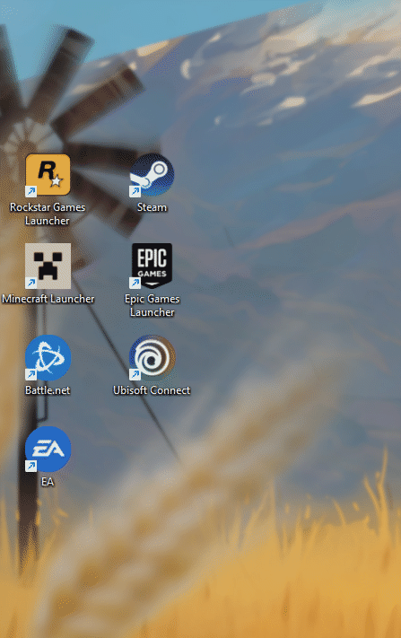
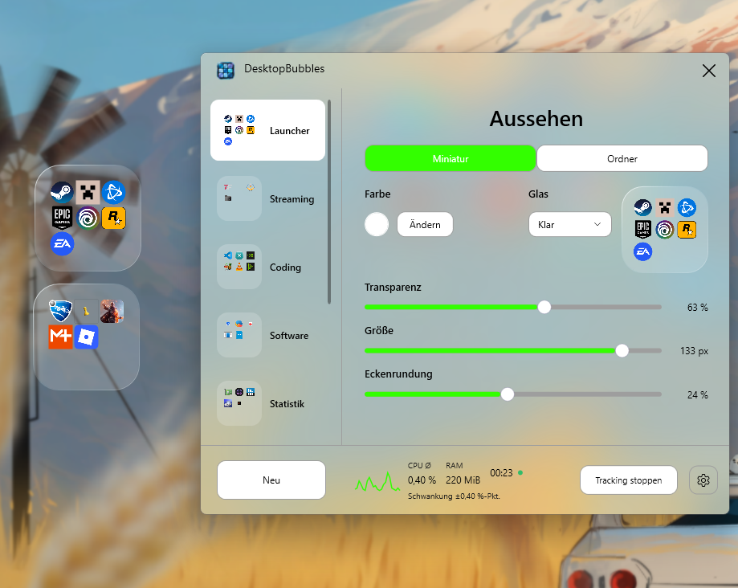

# DesktopBubbles — App folders & desktop organizer for Windows 11


**Many shortcuts. One bubble. More room for your desktop. ✨**

**Free, open-source app folders for Windows 11.** Organize desktop shortcuts into compact glass bubbles: click a bubble, choose an app, and return to a less cluttered desktop. Think iPhone-style folders for your PC, with drag-and-drop shortcuts and adjustable colors, sizes and transparency.

**Desktop aufräumen und Verknüpfungen gruppieren.** Steam, Epic, Battle.net und Co. müssen nicht einzeln den Desktop belegen. Pack sie in einen App-Ordner, öffne ihn mit einem Klick und wähle, was du starten möchtest. Danach bleibt wieder die kleine Miniatur. So bekommst du Smartphone-ähnliche Ordner für deinen Windows-Desktop. 🚀

**Version 1.7.0 · Windows 11 x64 · MIT license**

**[Windows-11-Installer herunterladen](https://github.com/Hendrik4K/DesktopBubbles/releases/download/v1.7.0/DesktopBubbles-Setup-1.7.0.exe)** · [Portable ZIP](https://github.com/Hendrik4K/DesktopBubbles/releases/download/v1.7.0/DesktopBubbles-win-x64-v1.7.0.zip) · [Release](https://github.com/Hendrik4K/DesktopBubbles/releases/latest) · [MIT-Lizenz](LICENSE) · [Fehler melden](https://github.com/Hendrik4K/DesktopBubbles/issues)

<table>
  <tr>
    <th>Vorher → Nachher</th>
    <th>Desktop-Bubbles &amp; Einstellungen</th>
  </tr>
  <tr>
    <td width="34%" valign="middle"></td>
    <td width="66%" valign="middle"></td>
  </tr>
</table>

## Organize shortcuts, launchers and workspaces

- **Gaming launcher organization:** keep shortcuts to Steam, Epic Games, Battle.net and other launchers together; the launchers themselves stay installed in their original locations.
- **Work and hobby groups:** separate coding tools, creative apps, folders and web links into desktop shortcut groups.
- **Desktop customization:** choose compact previews, folder sizes, colors and transparency for a minimalist desktop. An optional frosted-glass folder effect blurs the background once when opened, rather than continuously.
- **Drag and drop:** add shortcuts, move them between bubbles or return them to the desktop. Hold an icon until it wiggles, then drop it onto another to swap their positions.

## Funktionen: App-Ordner und Desktop-Anpassung

- **Neu in 1.7.0: installieren und loslegen.** Benutzer-Installer mit Startmenüeintrag, optionaler Desktop-Verknüpfung und geprüfter Datensicherung bei Updates. Persönliche Daten bleiben bei der Deinstallation erhalten.
- **Milchglas für Ordner:** eigener zuschaltbarer Effekt mit sauberen runden Ecken. Der Hintergrund wird beim Öffnen einmal weichgezeichnet übernommen; die Symbole bleiben scharf.
- **Korrigiert in 1.6.1:** „Mit Windows starten“ erkennt die tatsächlich eingetragene Programmdatei und ihren Datenordner. Eine ältere Ausgabe gilt nicht mehr fälschlich als Autostart der aktuellen. [Sicher umsteigen](docs/STARTUP.md).
- **Neu in 1.6.0: Halten. Wackeln. Tauschen.** Ein Symbol etwa eine halbe Sekunde gedrückt halten und auf ein anderes ziehen. Genau diese beiden tauschen ihre Plätze; die Reihenfolge bleibt gespeichert.
- Defekte Einträge über **Aus Gruppe löschen** entfernen, auch wenn das Ziel fehlt. Dateien und interne Sicherungskopien bleiben erhalten.
- Verknüpfungen, Programme, Ordner, Webadressen und installierte Store-Apps in Desktop-Bubbles organisieren.
- Einträge per Drag & Drop hinzufügen, sortieren, zwischen Gruppen verschieben und zurück auf den Desktop ziehen.
- Über **Zurück zum Desktop** eine geprüfte Verknüpfung zurücklegen. Programme werden nicht verschoben; bestehende Dateien bleiben erhalten.
- Miniaturgröße und Ordnergröße global anpassen; getrennte globale Transparenzen bis 100 Prozent und gemeinsame proportionale Rundung.
- Farben je Bubble oder optional für alle Bubbles gemeinsam wählen. Hell und Dunkel haben eigene anpassbare Grundfarben; Windows-Standard folgt dem Systemmodus.
- Ordner-Vorschau zwischen 1:3 und 1:1 umschalten; eingebetteter Farbeditor mit Farbkreis und HEX-Eingabe.
- Gruppen sichern/importieren, optional mit Windows starten und Ressourcen-Tracking ausdrücklich einschalten.

C# / WPF / Win32, ohne Browser-Runtime oder Administratorrechte. Keine Konten, Telemetrie oder automatischen Uploads. Das Öffnen gewählter Programme, Weblinks oder des Repositorys kann Netzwerkzugriffe auslösen.

## Download & installation / In wenigen Schritten loslegen

**English quick start:** download the Windows installer above, quit any running copy from its tray menu before updating, then install and launch **DesktopBubbles** from Windows Search. Click **Neu** to create a group, drag shortcuts onto it, and click its desktop bubble to choose an app. The interface currently uses German labels. The installer includes the .NET runtime; no separate runtime installation is needed. See the update and unsigned-app notes below before switching from a portable copy.

1. Den Installer von der [Release-Seite](https://github.com/Hendrik4K/DesktopBubbles/releases/latest) starten. Er installiert für dein Benutzerkonto und legt **DesktopBubbles** im Startmenü an. Die .NET-Desktop-Laufzeit ist enthalten.
2. **DesktopBubbles** über die Windows-Suche starten und mit **Neu** eine Bubble erstellen. Rechtsklick auf den Suchtreffer → **An Start anheften** funktioniert wie bei anderen Windows-Apps.
3. Verknüpfungen auf die Miniatur, ins geöffnete Raster oder auf die Gruppenzeile ziehen.
4. Miniatur anklicken und eine App auswählen. Zum Positionieren die geschlossene Bubble ziehen.

Das **X** schließt die Verwaltung; die Desktop-Bubbles bleiben aktiv. Ein Doppelklick auf das Tray-Symbol öffnet die Verwaltung. **Tray → Beenden** beendet die App vollständig. Das Tray-Menü enthält außerdem Version, Repository und Desktop-Verbindung erneuern.

Alternativ das portable ZIP vollständig in einen beschreibbaren Ordner entpacken und **DesktopBubbles.exe** starten. Es richtet keinen Startmenüeintrag automatisch ein.

**Bereits portable unterwegs?** Ein Installer-Update erhält vorhandene Daten unter `%LOCALAPPDATA%\Programs\DesktopBubbles\data`. Bei Daten an einem anderen Ort zuerst in der bisherigen App exportieren und den vollständigen Datenordner sichern; unterschiedliche portable Datenstände werden nicht automatisch zusammengeführt. [Sicher umsteigen](docs/STARTUP.md), [Installer und Datenerhalt](docs/INSTALLER.md).

Setup und App sind nicht signiert; Windows kann einen Hinweis auf einen unbekannten Herausgeber anzeigen. Es gibt keinen automatischen Updater. **Desktop-Anbindung ist experimentell**: normale Fenster dürfen die Bubbles überdecken. [Prüfstand und Plattformgrenzen](docs/TESTS.md).

## FAQ / Häufige Fragen zu Desktop-Ordnern

### Can I get iPhone-style app folders on Windows?

DesktopBubbles offers a similar interaction on Windows 11: a compact preview opens into a grid of shortcuts. It is an independent Windows app; the bubbles are its own windows rather than native Explorer folder icons.

### Wie kann ich meinen Desktop aufräumen, ohne Programme zu verschieben?

Ziehe die Verknüpfungen in eine Bubble für Gaming, Arbeit oder andere Aufgaben. Die installierten Programme bleiben an ihrem Ort. Persönliche Desktop-Verknüpfungen werden zunächst geprüft kopiert und standardmäßig danach vom Desktop entfernt. Diese Übernahme lässt sich in den Einstellungen auf reines Kopieren umstellen. Details stehen unter [Bedienung](#bedienung).

### Is this a game launcher or a replacement for the Windows Start menu?

It groups and opens your existing shortcuts. It does not install games, combine launcher accounts or replace Windows Search or the Start menu. You can also organize non-gaming apps, folders and web links.

### Ist der Desktop-Organizer kostenlos und auch portabel nutzbar?

Ja. DesktopBubbles ist unter MIT veröffentlicht. Es gibt einen Benutzer-Installer und eine portable ZIP; beide sind oben verlinkt. Zum Ausprobieren ist kein Konto erforderlich. Beachte die Hinweise zu Datensicherung, unsignierten Downloads und experimenteller Desktop-Anbindung unter Installation und [Bekannte Grenzen](#bekannte-grenzen).

## Bedienung

| Aktion | Bedienung |
| --- | --- |
| Öffnen / schließen | Miniatur anklicken; Raster mit Esc oder Klick außerhalb schließen |
| Gruppe finden | Rechtsklick auf Gruppenzeile → Auf dem Desktop finden; zeigt den Desktop und setzt die Bubble in die Hauptmonitormitte |
| Gruppe bearbeiten | Rechtsklick auf Miniatur oder Gruppenzeile; Umbenennen und Name unter Bubble anzeigen stehen oben |
| Einträge hinzufügen | Drag & Drop oder Gruppenmenü → Hinzufügen |
| Plätze tauschen | Symbol etwa ½ Sekunde halten, bis die Symbole wackeln; auf einem anderen Symbol loslassen |
| Sortieren beenden | Esc oder eine freie Stelle im Ordner anklicken |
| Andere Bubble / Desktop | Ohne Haltepause direkt auf die Ziel-Bubble beziehungsweise den Desktop ziehen |
| Zurück auf den Desktop | Symbol hinausziehen oder Rechtsklick → Zurück zum Desktop |
| Nur aus der Gruppe entfernen | Rechtsklick auf Symbol → Aus Gruppe löschen; funktioniert auch bei fehlendem oder defektem Ziel |
| Einstellungen verlassen | Erneut Zahnrad unten rechts oder Zurück-Pfeil → Miniaturansicht |
| Tastatur | Tab / Umschalt+Tab, Enter / Leertaste; Strg+N erstellt eine Gruppe |

Persönliche Desktop-`.lnk/.url` erhalten zuerst eine geprüfte eigene Kopie. Standardmäßig entfernt die App danach das geprüfte Desktop-Original. **Einstellungen → Desktop-Originale nach Übernahme entfernen** ausschalten, um neue Links nur zu kopieren. Programme, Dateien, Ordner und gemeinsame Desktop-Originale bleiben am Ort. Bei der Rückgabe wird zuerst eine unabhängige Verknüpfung auf dem persönlichen Desktop angelegt und erst danach der Eintrag entfernt. Namenskonflikte erhalten einen neuen Namen. Bei Fehlern bleibt der Eintrag erhalten. [Verknüpfungen und Rückgabe](docs/SHORTCUTS.md).

## Aussehen

Gruppe links auswählen. **Miniatur** enthält Farbe, Glas, globale Miniaturtransparenz und -größe sowie die gemeinsame Eckenrundung. **Ordner** enthält die getrennte globale Ordnertransparenz, Ordnergröße und Live-Vorschau mit 1:3-/1:1-Umschaltung. Bei 100 Prozent Transparenz verschwinden Fläche und Rahmen; die Symbole bleiben sichtbar.


**Ändern** öffnet den Farbeditor über den unteren Reglern. Der Entwurf verändert keine gespeicherten Farben. **Anwenden** übernimmt, **Abbrechen** oder Esc verwirft die Auswahl. HEX akzeptiert sechs RGB-Stellen. Andere Regler wirken sofort und werden automatisch gespeichert.

Das Zahnrad enthält App-Farbe, Farbmodus und App-Transparenz. Die **quadratische Farbkachel neben Farbmodus** bearbeitet die Grundfarbe von Hell oder Dunkel. Bei Windows-Standard wird das aktuell aktive Profil bearbeitet. Diese Farben betreffen DesktopBubbles, nicht die Windows-Systemfarben. Unter **Allgemein** koppelt **Bubble-Farben für alle übernehmen** die Gruppenfarben. **Farben zurücksetzen** setzt App-, Bubble- und Modusfarben zurück; Größen, Transparenzen und Kopplungswahl bleiben erhalten.

**Klar** ist leichter und farbiger, **Matt** dichter. Die Verwaltung nutzt DWM-Unschärfe, sofern verfügbar und eingeschaltet. Unter **Ordner → Milchglas** lässt sich ein eigener Effekt einschalten: Grün bedeutet aktiv, der normale Transparenzregler wird ausgeblendet. Beim Ausschalten kehren der normale Stil und der bisherige Transparenzwert zurück. Milchglas übernimmt nur beim Öffnen einen kleinen Hintergrundbereich im Arbeitsspeicher und weichzeichnet ihn. Bewegungen dahinter erscheinen beim nächsten Öffnen; die App speichert oder überträgt diese Aufnahme nicht. Hoher Kontrast verwendet Systemfarben. [Milchglas und Grenzen](docs/FROSTED-FOLDERS.md).

## Ressourcen und Daten

**Tracking starten** aktiviert zeitgewichteten CPU-Durchschnitt über alle logischen Prozessoren, aktuellen RAM (Working Set), Verlauf und aktive Dauer. **Tracking stoppen** hält die Werte fest; erneuter Start beginnt eine neue Messung. Ausblenden/Minimieren unterbricht die Messung, Schließen beendet sie. Standardmäßig läuft kein Tracking. Die angezeigte Schwankung ist keine Messgenauigkeit. [Methodik](docs/PERFORMANCE.md).

**Einstellungen → Daten & Werkzeuge** enthält Sicherung exportieren/importieren, Verknüpfungen auf Desktop zurücklegen, Programmordner öffnen, Desktop-Bubbles neu verbinden und Diagnosebericht speichern. Der Diagnosebericht misst den eigenen Prozess zehn Sekunden lang und bleibt lokal.

## Aktualisieren, sichern und entfernen

Den aktiven Speicher unter **Einstellungen → Datenordner öffnen** ermitteln, dann die bisherige App **im Tray beenden**. Die neue Version in einen eigenen Ordner entpacken und den **vollständigen aktiven Datenordner** übernehmen oder mit --data-dir weiterverwenden. Alternativ eine `.bubbles`-Sicherung importieren. Release-ZIPs enthalten keine Benutzerdaten.

**Beim Wechsel zwischen Ausgaben:** Vorschau und installierte Version können unterschiedliche Datenordner verwenden. Wähle den Stand mit deinen neuesten Gruppen und übernimm diesen vollständig. Aktiviere anschließend in der gewünschten Ausgabe **Mit Windows starten**, damit Windows genau diese Programmdatei mit diesem Datenordner öffnet. Version 1.6.1 zeigt einen abweichenden vorhandenen Eintrag als ausgeschaltet und erklärt ihn im Tooltip. Datenstände werden nicht automatisch zusammengeführt. [Autostart und Datenübernahme](docs/STARTUP.md).

Version 1.5.0 migriert ältere Konfigurationen auf **Schema 6**. Beide Transparenzen gelten danach global; bei alten Einzelwerten wird je Ansicht der wirksame Wert der ersten Gruppe übernommen. Gruppen und Verknüpfungen bleiben erhalten. Migrierte Daten anschließend nicht mit älteren Ausgaben öffnen. Alte Einträge werden beim Upgrade nicht automatisch vom Desktop verschoben.

`portable.flag` bevorzugt `data/groups.json` neben der EXE. Ist dieser Ordner nicht beschreibbar, etwa unter Program Files, übernimmt die App vorhandene Daten nach `%LOCALAPPDATA%\DesktopBubbles\profiles\<Kennung>`. Die Kennung trennt unterschiedliche Ausgangsordner; deren Daten werden nicht vermischt. Einmal umgeleitete Ordner verwenden weiter ihre neuere Kopie. Die Quelle bleibt unverändert. Ohne Flag/`--portable` liegt der Zustand unter `%LOCALAPPDATA%\DesktopBubbles`. Eigene Datenpfade sind über `--data-dir "D:\Meine Einstellungen\DesktopBubbles"` möglich; auch diese werden bei fehlenden Schreibrechten umgeleitet. `--background` startet ohne Verwaltung.

**Einstellungen → Datenordner öffnen** zeigt den tatsächlich aktiven Speicher. Diesen vollständigen Ordner vor einem Umzug oder Upgrade sichern und mitnehmen beziehungsweise über --data-dir weiterverwenden. Im Hell-/Dunkel-Farbeditor steuert **Deckkraft** die Transparenz der Steuerelement-Hintergründe getrennt von Helligkeit und App-/Bubble-Transparenz. Nutzer älterer Ausgaben mit blockierter Speicherung sollten noch ungespeicherte Änderungen vor dem Beenden zusätzlich exportieren.

Export enthält Gruppen, Einstellungen und referenzierte interne Verknüpfungen. Import ersetzt den Zustand nach Rückfrage und sichert den bisherigen Stand zusätzlich. Programme, externe Ziele und die ganze Rückgabehistorie sind nicht vollständig enthalten. Für eine vollständige Sicherung bei beendeter App den gesamten `data`-Ordner kopieren.

Vor Löschen der App **Einstellungen → Verknüpfungen auf Desktop zurücklegen** ausführen, bei Bedarf Daten sichern, Autostart ausschalten und im Tray beenden. Löschen des Datenordners kann die einzige Kopie übernommener Links entfernen. Autostart schreibt auf ausdrückliche Bedienung nach `HKCU\Software\Microsoft\Windows\CurrentVersion\Run`; vor einem Umzug ausschalten und am neuen Ort bei Bedarf neu aktivieren.

## Bauen und mitarbeiten

Windows 11 x64 und .NET-8-SDK beziehungsweise Visual Studio mit .NET-Desktopentwicklung. Keine Drittanbieter-NuGet-Laufzeitabhängigkeiten.

```powershell
.\Build.ps1 -InstallSdk -OutputName DesktopBubbles-win-x64-v1.7.0
# Mit vorhandenem SDK:
.\Build.ps1 -OutputName DesktopBubbles-win-x64-v1.7.0
# Native Tests mit isolierten Testdaten auf interaktivem Windows-Desktop:
.\Test-Windows.ps1 -Executable .\artifacts\DesktopBubbles-win-x64-v1.7.0\DesktopBubbles.exe
# Optionaler Installer-Build:
.\tools\Get-InnoSetup.ps1
.\tools\Build-Installer.ps1 -Payload .\artifacts\DesktopBubbles-win-x64-v1.7.0
```

Build erstellt die portable Ausgabe, führt die Kernprüfungen aus und packt ZIPs sowie SHA-256-Prüfsummen. Native Tests laufen separat. `dotnet test` ist nicht der Einstieg für die ausführbare Konsolensuite. CI baut App und Installer und prüft Core sowie isolierte Installer-Abläufe auf GitHub Actions. Inno Setup ist nur ein zusätzliches Buildwerkzeug. [Architektur](docs/ARCHITECTURE.md), [Entwicklerregeln](docs/DEVELOPMENT.md), [Release](docs/RELEASE.md), [Design-QA](design-qa.md).

Feedback zu Bugs, Bedienung und Tests auf weiteren Windows-Systemen ist unter [Issues](https://github.com/Hendrik4K/DesktopBubbles/issues) willkommen. Bitte Konfigurationen oder Logs mit privaten Pfaden vor dem Upload prüfen.

## Bekannte Grenzen

- Bubbles sind eigene Desktop-Toolfenster mit Desktop-Besitzer, keine Explorer-Icons. Keine Hooks, Explorer-Patches oder Topmost-Overlays.
- Mehrere Monitore, gemischte DPI, virtuelle Desktops, echter Explorer-Neustart und physisches Win+D benötigen weitere Plattformtests.
- Physisches Explorer-Drag-&-Drop, Cloud-/Netzwerkpfade, Sonderlinks, Store-Starts und UAC-Fälle sind nicht umfassend abgenommen. Ohne verlässliche Übergabebestätigung bleibt ein herausgezogener Eintrag erhalten.
- WPF-Aufnahmen erfassen nicht den vom Desktop zusammengesetzten Hintergrund. Hoher Kontrast und verschiedene Skalierungen müssen zusätzlich visuell geprüft werden.
- WPF hat einen Speichergrundbedarf. CPU-/RAM-Messungen belegen keine Spiele-Frametimes oder GPU-Leistung.

Eigener Projektcode unter MIT. Das Rauchglas-Logo, das Demo-GIF und die Desktop-Aufnahme wurden vom Projektinhaber bereitgestellt und unverändert übernommen; App-Symbole stammen aus der lokalen Windows-Shell. Die portable Ausgabe enthält die Lizenzhinweise ihrer .NET-Laufzeit. [Branding](src/DesktopBubbles/Assets/README.md).
