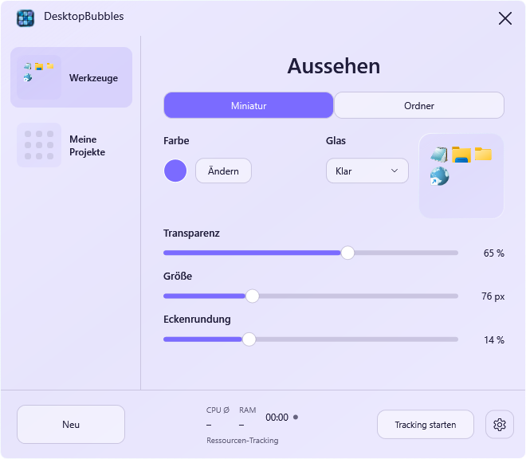

# DesktopBubbles · 1.5.0


**App folders for your Windows 11 desktop.** Group your shortcuts into a small bubble, open it with one click, and launch the app you need.

Native App-Ordner für den vorhandenen Windows-Desktop. Statt vieler einzelner Verknüpfungen liegt eine kompakte Miniatur auf dem Desktop. Ein Klick öffnet das App-Raster über der Bubble; nach dem Schließen erscheint wieder die Miniatur.

**[Windows 11 x64 herunterladen](https://github.com/Hendrik4K/DesktopBubbles/releases/latest)** · [Änderungen](CHANGELOG.md) · [MIT-Lizenz](LICENSE) · [Fehler melden](https://github.com/Hendrik4K/DesktopBubbles/issues)



## Funktionen

- Verknüpfungen, Programme, Ordner, Webadressen und installierte Store-Apps in Desktop-Bubbles organisieren.
- Einträge per Drag & Drop hinzufügen, sortieren, zwischen Gruppen verschieben und zurück auf den Desktop ziehen.
- Über **Zurück zum Desktop** eine geprüfte Verknüpfung zurücklegen. Programme werden nicht verschoben; bestehende Dateien bleiben erhalten.
- Miniaturgröße und Ordnergröße global anpassen; getrennte globale Transparenzen bis 100 Prozent und gemeinsame proportionale Rundung.
- Farben je Bubble oder optional für alle Bubbles gemeinsam wählen. Hell und Dunkel haben eigene anpassbare Grundfarben; Windows-Standard folgt dem Systemmodus.
- Ordner-Vorschau zwischen 1:3 und 1:1 umschalten; eingebetteter Farbeditor mit Farbkreis und HEX-Eingabe.
- Gruppen sichern/importieren, optional mit Windows starten und Ressourcen-Tracking ausdrücklich einschalten.

C# / WPF / Win32, ohne Browser-Runtime oder Administratorrechte. Keine Konten, Telemetrie oder automatischen Uploads. Das Öffnen gewählter Programme, Weblinks oder des Repositorys kann Netzwerkzugriffe auslösen.

## Loslegen

1. Das portable ZIP von der [Release-Seite](https://github.com/Hendrik4K/DesktopBubbles/releases/latest) herunterladen und vollständig in einen beschreibbaren Ordner entpacken. Die .NET-Desktop-Laufzeit ist enthalten.
2. **DesktopBubbles.exe** starten und mit **Neu** eine Bubble erstellen.
3. Verknüpfungen auf die Miniatur, ins geöffnete Raster oder auf die Gruppenzeile ziehen.
4. Miniatur anklicken und eine App auswählen. Zum Positionieren die geschlossene Bubble ziehen.

Das **X** schließt die Verwaltung; die Desktop-Bubbles bleiben aktiv. Ein Doppelklick auf das Tray-Symbol öffnet die Verwaltung. **Tray → Beenden** beendet die App vollständig. Das Tray-Menü enthält außerdem Version, Repository und Desktop-Verbindung erneuern.

Die portable Ausgabe ist nicht signiert und enthält keinen Installer oder automatischen Updater. **Desktop-Anbindung ist experimentell**: normale Fenster dürfen die Bubbles überdecken. [Prüfstand und Plattformgrenzen](docs/TESTS.md).

## Bedienung

| Aktion | Bedienung |
| --- | --- |
| Öffnen / schließen | Miniatur anklicken; Raster mit Esc oder Klick außerhalb schließen |
| Gruppe finden | Rechtsklick auf Gruppenzeile → Auf dem Desktop finden; zeigt den Desktop und setzt die Bubble in die Hauptmonitormitte |
| Gruppe bearbeiten | Rechtsklick auf Miniatur oder Gruppenzeile; Umbenennen und Name unter Bubble anzeigen stehen oben |
| Einträge hinzufügen | Drag & Drop oder Gruppenmenü → Hinzufügen |
| Sortieren / andere Bubble | Symbol auf anderes Symbol beziehungsweise Ziel-Bubble ziehen |
| Zurück auf den Desktop | Symbol hinausziehen oder Rechtsklick → Zurück zum Desktop |
| Einstellungen verlassen | Erneut Zahnrad unten rechts oder Zurück-Pfeil → Miniaturansicht |
| Tastatur | Tab / Umschalt+Tab, Enter / Leertaste; Strg+N erstellt eine Gruppe |

Persönliche Desktop-`.lnk/.url` erhalten zuerst eine geprüfte eigene Kopie. Standardmäßig entfernt die App danach das geprüfte Desktop-Original. **Einstellungen → Desktop-Originale nach Übernahme entfernen** ausschalten, um neue Links nur zu kopieren. Programme, Dateien, Ordner und gemeinsame Desktop-Originale bleiben am Ort. Bei der Rückgabe wird zuerst eine unabhängige Verknüpfung auf dem persönlichen Desktop angelegt und erst danach der Eintrag entfernt. Namenskonflikte erhalten einen neuen Namen. Bei Fehlern bleibt der Eintrag erhalten. [Verknüpfungen und Rückgabe](docs/SHORTCUTS.md).

## Aussehen

Gruppe links auswählen. **Miniatur** enthält Farbe, Glas, globale Miniaturtransparenz und -größe sowie die gemeinsame Eckenrundung. **Ordner** enthält die getrennte globale Ordnertransparenz, Ordnergröße und Live-Vorschau mit 1:3-/1:1-Umschaltung. Bei 100 Prozent Transparenz verschwinden Fläche und Rahmen; die Symbole bleiben sichtbar.

**Ändern** öffnet den Farbeditor über den unteren Reglern. Der Entwurf verändert keine gespeicherten Farben. **Anwenden** übernimmt, **Abbrechen** oder Esc verwirft die Auswahl. HEX akzeptiert sechs RGB-Stellen. Andere Regler wirken sofort und werden automatisch gespeichert.

Das Zahnrad enthält App-Farbe, Farbmodus und App-Transparenz. Die **quadratische Farbkachel neben Farbmodus** bearbeitet die Grundfarbe von Hell oder Dunkel. Bei Windows-Standard wird das aktuell aktive Profil bearbeitet. Diese Farben betreffen DesktopBubbles, nicht die Windows-Systemfarben. Unter **Allgemein** koppelt **Bubble-Farben für alle übernehmen** die Gruppenfarben. **Farben zurücksetzen** setzt App-, Bubble- und Modusfarben zurück; Größen, Transparenzen und Kopplungswahl bleiben erhalten.

**Klar** ist leichter und farbiger, **Matt** dichter. Die Verwaltung nutzt DWM-Unschärfe, sofern verfügbar und eingeschaltet. Geöffnete Ordner verwenden eigene transparente Farbflächen; dort ist Matt eine Materialtönung ohne echten Desktop-Blur. Hoher Kontrast verwendet Systemfarben. Rundung und Größen bleiben proportional; Größenangaben entsprechen 100 Prozent Windows-Skalierung.

## Ressourcen und Daten

**Tracking starten** aktiviert zeitgewichteten CPU-Durchschnitt über alle logischen Prozessoren, aktuellen RAM (Working Set), Verlauf und aktive Dauer. **Tracking stoppen** hält die Werte fest; erneuter Start beginnt eine neue Messung. Ausblenden/Minimieren unterbricht die Messung, Schließen beendet sie. Standardmäßig läuft kein Tracking. Die angezeigte Schwankung ist keine Messgenauigkeit. [Methodik](docs/PERFORMANCE.md).

**Einstellungen → Daten & Werkzeuge** enthält Sicherung exportieren/importieren, Verknüpfungen auf Desktop zurücklegen, Programmordner öffnen, Desktop-Bubbles neu verbinden und Diagnosebericht speichern. Der Diagnosebericht misst den eigenen Prozess zehn Sekunden lang und bleibt lokal.

## Aktualisieren, sichern und entfernen

Die bisherige App **im Tray beenden**. Die neue Version in einen eigenen Ordner entpacken und den **vollständigen bisherigen `data`-Ordner** übernehmen. Alternativ eine `.bubbles`-Sicherung importieren. Release-ZIPs enthalten keine Benutzerdaten.

Version 1.5.0 migriert ältere Konfigurationen auf **Schema 6**. Beide Transparenzen gelten danach global; bei alten Einzelwerten wird je Ansicht der wirksame Wert der ersten Gruppe übernommen. Gruppen und Verknüpfungen bleiben erhalten. Migrierte Daten anschließend nicht mit älteren Ausgaben öffnen. Alte Einträge werden beim Upgrade nicht automatisch vom Desktop verschoben.

`portable.flag` aktiviert `data/groups.json` neben der EXE. Ohne Flag/`--portable` liegt der Zustand unter `%LOCALAPPDATA%\DesktopBubbles`. Eigene Datenpfade sind über `--data-dir "D:\Meine Einstellungen\DesktopBubbles"` möglich; `--background` startet ohne Verwaltung.

Export enthält Gruppen, Einstellungen und referenzierte interne Verknüpfungen. Import ersetzt den Zustand nach Rückfrage und sichert den bisherigen Stand zusätzlich. Programme, externe Ziele und die ganze Rückgabehistorie sind nicht vollständig enthalten. Für eine vollständige Sicherung bei beendeter App den gesamten `data`-Ordner kopieren.

Vor Löschen der App **Einstellungen → Verknüpfungen auf Desktop zurücklegen** ausführen, bei Bedarf Daten sichern, Autostart ausschalten und im Tray beenden. Löschen des Datenordners kann die einzige Kopie übernommener Links entfernen. Autostart schreibt auf ausdrückliche Bedienung nach `HKCU\Software\Microsoft\Windows\CurrentVersion\Run`; vor einem Umzug ausschalten und am neuen Ort bei Bedarf neu aktivieren.

## Bauen und mitarbeiten

Windows 11 x64 und .NET-8-SDK beziehungsweise Visual Studio mit .NET-Desktopentwicklung. Keine Drittanbieter-NuGet-Laufzeitabhängigkeiten.

```powershell
.\Build.ps1 -InstallSdk -OutputName DesktopBubbles-win-x64-v1.5.0
# Mit vorhandenem SDK:
.\Build.ps1 -OutputName DesktopBubbles-win-x64-v1.5.0
# Native Tests mit isolierten Testdaten auf interaktivem Windows-Desktop:
.\Test-Windows.ps1 -Executable .\artifacts\DesktopBubbles-win-x64-v1.5.0\DesktopBubbles.exe
```

Build erstellt die portable Ausgabe, führt die Kernprüfungen aus und packt ZIPs sowie SHA-256-Prüfsummen. Native Tests laufen separat. `dotnet test` ist nicht der Einstieg für die ausführbare Konsolensuite. CI baut und prüft den Core auf GitHub Actions. [Architektur](docs/ARCHITECTURE.md), [Entwicklerregeln](docs/DEVELOPMENT.md), [Release](docs/RELEASE.md), [Design-QA](design-qa.md).

Feedback zu Bugs, Bedienung und Tests auf weiteren Windows-Systemen ist unter [Issues](https://github.com/Hendrik4K/DesktopBubbles/issues) willkommen. Bitte Konfigurationen oder Logs mit privaten Pfaden vor dem Upload prüfen.

## Bekannte Grenzen

- Bubbles sind eigene Desktop-Toolfenster mit Desktop-Besitzer, keine Explorer-Icons. Keine Hooks, Explorer-Patches oder Topmost-Overlays.
- Mehrere Monitore, gemischte DPI, virtuelle Desktops, echter Explorer-Neustart und physisches Win+D benötigen weitere Plattformtests.
- Physisches Explorer-Drag-&-Drop, Cloud-/Netzwerkpfade, Sonderlinks, Store-Starts und UAC-Fälle sind nicht umfassend abgenommen. Ohne verlässliche Übergabebestätigung bleibt ein herausgezogener Eintrag erhalten.
- WPF-Aufnahmen erfassen nicht den vom Desktop zusammengesetzten Hintergrund. Hoher Kontrast und verschiedene Skalierungen müssen zusätzlich visuell geprüft werden.
- WPF hat einen Speichergrundbedarf. CPU-/RAM-Messungen belegen keine Spiele-Frametimes oder GPU-Leistung.

Eigener Projektcode unter MIT. Das Rauchglas-Logo wurde vom Projektinhaber bereitgestellt; App-Symbole stammen aus der lokalen Windows-Shell. Die portable Ausgabe enthält die Lizenzhinweise ihrer .NET-Laufzeit. [Branding](src/DesktopBubbles/Assets/README.md).
