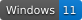
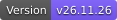
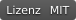
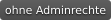
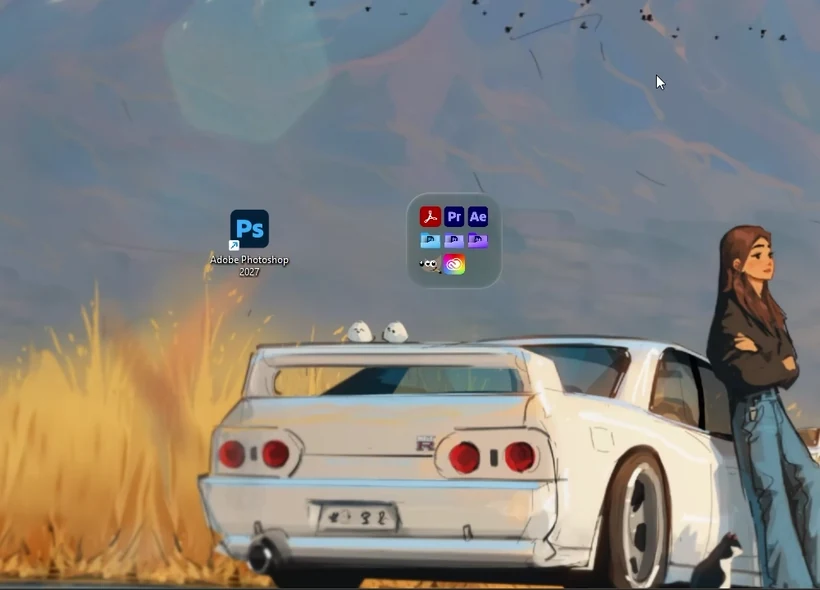
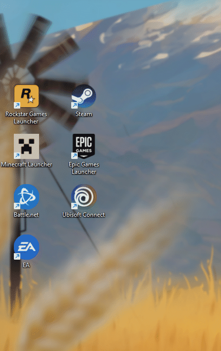
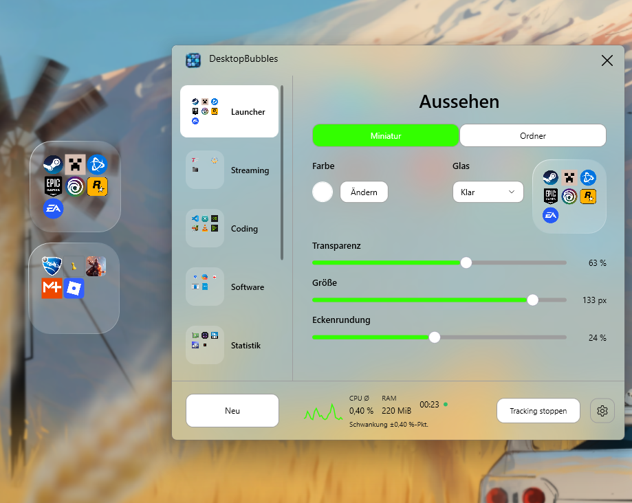
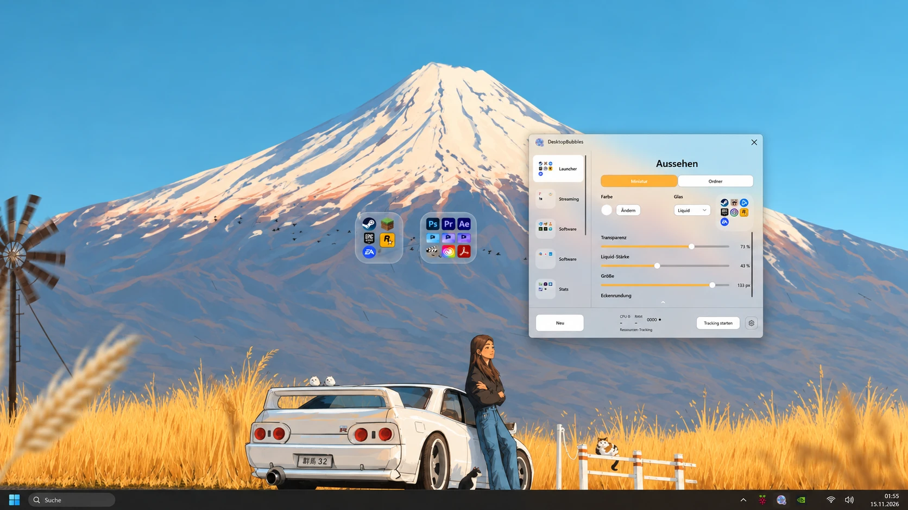

# DesktopBubbles <a href="README.en.md"></a><a href="README.md"></a>

**App-Ordner für den Windows-11-Desktop: Viele Verknüpfungen, eine gläserne Bubble, und dein Desktop hat wieder Luft.**

<p align="center"> <a href="https://github.com/Hendrik4K/DesktopBubbles/releases/latest"></a> <a href="LICENSE"></a>  <a href="https://github.com/Hendrik4K/DesktopBubbles/actions/workflows/windows.yml"></a></p>

<p align="center"></p>

Ordner wie auf dem Smartphone, nur für deinen PC: Steam, Epic, Photoshop und Co. ziehst du in eine Bubble, ein Klick öffnet sie, du wählst die App, und zurück bleibt eine kleine Miniatur. Die Programme selbst bleiben, wo sie sind. Dazu Liquid Glass, das den echten Hintergrund an den Kanten bricht wie eine Linse, weil ein aufgeräumter Desktop ruhig auch gut aussehen darf.

<table>
  <tr>
    <th>Vorher → Nachher</th>
    <th>Bubbles &amp; Verwaltung</th>
  </tr>
  <tr>
    <td width="34%" valign="middle"></td>
    <td width="66%" valign="middle"></td>
  </tr>
</table>

<details>
<summary><b>🚀 Schnellstart</b></summary>

1. Den Installer unter **[Releases](https://github.com/Hendrik4K/DesktopBubbles/releases/latest)** herunterladen und starten. Er installiert nur für dich, ohne Adminrechte, und bringt die .NET-Laufzeit gleich mit. Meldet Windows SmartScreen „Der Computer wurde durch Windows geschützt“: **Weitere Informationen → Trotzdem ausführen** (der Installer ist nicht code-signiert).
2. **DesktopBubbles** über die Windows-Suche starten und mit **Neu** eine Bubble anlegen.
3. Verknüpfungen vom Desktop auf die Bubble ziehen.
4. Bubble anklicken, App auswählen. Fertig.

Die App wartet danach im Infobereich der Taskleiste; ein Klick auf das Seifenblasen-Symbol öffnet die Verwaltung. **Tray → Beenden** beendet sie ganz. Lieber ohne Installation? Das **portable ZIP** aus den Releases in einen beschreibbaren Ordner entpacken und `DesktopBubbles.exe` starten.

**Selbst bauen (für Bastler):** Windows 11 x64 und das .NET-8-SDK (oder Visual Studio mit .NET-Desktopentwicklung). Keine NuGet-Abhängigkeiten von Drittanbietern.

```powershell
.\Build.ps1 -InstallSdk -OutputName DesktopBubbles-win-x64
.\Test-Windows.ps1 -Executable .\artifacts\DesktopBubbles-win-x64\DesktopBubbles.exe
.\tools\Get-InnoSetup.ps1
.\tools\Build-Installer.ps1 -Payload .\artifacts\DesktopBubbles-win-x64
```

`Build.ps1` baut die portable Ausgabe, führt die Kernprüfungen aus und packt ZIP und SHA-256-Prüfsummen. `Test-Windows.ps1` prüft die echte App auf einem interaktiven Desktop mit eigenen Testdaten. Mehr unter [Architektur](docs/ARCHITECTURE.md), [Entwicklerregeln](docs/DEVELOPMENT.md) und [Release](docs/RELEASE.md).

</details>

<details>
<summary><b>💡 Was es kann</b></summary>

- **App-Ordner auf dem Desktop.** Verknüpfungen, Programme, Ordner, Webadressen und Store-Apps in Bubbles gruppieren: Gaming, Arbeit, Kreativ, was du willst.
- **Liquid Glass und Milchglas.** Liquid Glass bricht den echten Hintergrund an den Kanten wie eine Linse, die Stärke ist einstellbar. Milchglas zeichnet ihn weich. Die Symbole bleiben dabei immer scharf.
- **Ordner mit Schwung.** Ordner springen aus der Miniatur auf, die Symbole fliegen an ihren Platz und beim Schließen wieder zurück.
- **Halten, wackeln, tauschen.** Ein Symbol eine halbe Sekunde halten, bis alles wackelt, dann auf ein anderes ziehen: Die beiden tauschen die Plätze.
- **Drag & Drop überall.** Rein in die Bubble, raus auf den Desktop, rüber in eine andere Bubble.
- **Aufgeräumt bleibt aufgeräumt.** Legt ein Programm-Update seine Verknüpfung wieder auf den Desktop, wandert sie automatisch zurück in ihre Bubble.
- **Farben nach Geschmack.** Farbe je Bubble oder für alle gemeinsam, Farbkreis, HEX-Eingabe und Pipette, die eine Farbe direkt vom Bildschirm aufnimmt. Hell, Dunkel oder wie Windows.
- **Größe und Transparenz.** Miniatur und Ordner getrennt einstellbar, Transparenz bis 100 Prozent, Ordnervorschau 1:3 oder 1:1.
- **Schließt von selbst.** Auf Wunsch schließt ein Ordner nach einstellbaren Sekunden ohne Maus.
- **Deutsch oder Englisch.** Ein Klick auf den Sprachschalter in den Einstellungen, und alles wechselt die Sprache.
- **Messleiste.** Wer wissen will, was die App kostet: CPU und RAM als kleiner Tacho mit Verlauf, nur wenn du sie startest.
- **Dezent.** Kein Konto, keine Telemetrie, keine Adminrechte. Die App wartet still im Infobereich.

<ins>Warum es das gibt:</ins> Mein Desktop war voller Launcher, und eine schlichte Ordnerlösung wie auf dem Handy gab es für Windows nicht. Also habe ich sie gebaut und stelle sie allen zur Verfügung.

</details>

<details>
<summary><b>📷 Mehr Bilder</b></summary>

<!-- Platz für weitere GIFs: 1:3 ↔ 1:1, Farbwähler mit Pipette, Sprachschalter, Messleiste -->
<p align="center"></p>

</details>

<details>
<summary><b>🖱️ Bedienung</b></summary>

| Aktion | So geht's |
| --- | --- |
| Öffnen / schließen | Miniatur anklicken; Esc oder Klick daneben schließt |
| Bubble verschieben | Geschlossene Miniatur ziehen |
| Einträge hinzufügen | Per Drag & Drop oder Rechtsklick auf die Miniatur → Hinzufügen |
| Plätze tauschen | Symbol ½ Sekunde halten, bis alles wackelt, dann auf einem anderen Symbol loslassen |
| In eine andere Bubble | Ohne Haltepause direkt auf die andere Bubble ziehen |
| Zurück auf den Desktop | Symbol hinausziehen oder Rechtsklick → Zurück zum Desktop |
| Nur aus der Gruppe entfernen | Rechtsklick auf Symbol → Aus Gruppe löschen (klappt auch bei defektem Ziel) |
| Bubble wiederfinden | Rechtsklick auf die Gruppenzeile → Auf dem Desktop finden |
| Einstellungen | Zahnrad unten rechts; erneut klicken oder Zurück-Pfeil führt zurück |
| Tastatur | Tab / Umschalt+Tab, Enter / Leertaste; Strg+N legt eine Bubble an |

Persönliche Desktop-Verknüpfungen werden zuerst geprüft kopiert, danach entfernt die App das Original vom Desktop. Wer nur kopieren will, schaltet **Einstellungen → Desktop-Originale nach Übernahme entfernen** aus. Programme, Dateien und Ordner werden nie verschoben. Beim Zurücklegen entsteht zuerst die neue Verknüpfung auf dem Desktop, erst dann verschwindet der Eintrag. Details: [Verknüpfungen und Rückgabe](docs/SHORTCUTS.md).

</details>

<details>
<summary><b>🧰 Voraussetzungen, Daten und Updates</b></summary>

**Voraussetzungen:** Windows 11 x64. Der Installer bringt alles mit, was die App braucht.

**Deine Daten** liegen bei der installierten Version unter `%LOCALAPPDATA%\Programs\DesktopBubbles\data`. **Einstellungen → Datenordner öffnen** zeigt immer den tatsächlich genutzten Ordner. Unter **Einstellungen → Daten & Werkzeuge** kannst du Sicherungen (`.bubbles`) exportieren und importieren, alle Verknüpfungen auf den Desktop zurücklegen und einen lokalen Diagnosebericht speichern.

**Updates:** Die laufende App im Tray beenden, dann den neuen Installer starten. Deine Bubbles bleiben erhalten, der Installer sichert sie vorher. Eine automatische Update-Installation gibt es nicht; das Tray-Menü kann aber nach neuen Versionen suchen.

**Deinstallieren:** Vorher **Einstellungen → Verknüpfungen auf Desktop zurücklegen** ausführen, sonst liegen übernommene Verknüpfungen nur noch im Datenordner. Die Deinstallation lässt deine Daten stehen.

<details>
<summary>🆘 <b>Für Umsteiger:</b> portable Version, eigene Datenordner und Autostart</summary>

Die portable Version speichert neben der EXE in `data\` (über `portable.flag`). Ist dieser Ordner nicht beschreibbar, etwa unter Program Files, weicht sie nach `%LOCALAPPDATA%\DesktopBubbles\profiles\<Kennung>` aus. Eigene Speicherorte gehen mit `--data-dir "D:\Mein Ordner"`, `--background` startet ohne Verwaltung.

Vorschau, portable und installierte Version können verschiedene Datenordner haben, die nie automatisch zusammengeführt werden. Beim Umstieg den Ordner mit deinen neuesten Bubbles komplett übernehmen oder vorher exportieren und danach importieren. **Mit Windows starten** danach in genau der Version einschalten, die bleiben soll. Mehr dazu: [Sicher umsteigen](docs/STARTUP.md), [Installer und Datenerhalt](docs/INSTALLER.md).

</details>

</details>

<details>
<summary><b>⚡ Technik und Sicherheit</b></summary>

**So funktioniert's**

- C# mit WPF und Win32, ohne Browser-Runtime. Die Bubbles sind eigene kleine Fenster, die dem Desktop gehören, keine Explorer-Icons. Keine Hooks, keine Explorer-Patches, nichts, was immer im Vordergrund klebt.
- **Glas-Effekte:** Für Liquid Glass und Milchglas nimmt die App beim Öffnen einen kleinen Ausschnitt des Bildschirms hinter dem Ordner auf und verarbeitet ihn im Arbeitsspeicher. Die Stelle unter der eigenen Miniatur füllt sie mit dem Desktopbild, das Windows ohne die Bubbles liefert. So bleibt die Miniatur auch in Bildschirmaufnahmen wie OBS durchgehend sichtbar.
- **Messleiste:** misst nur den eigenen Prozess und nur, solange du sie laufen lässt. Methodik: [Leistung](docs/PERFORMANCE.md).

**Sicherheit und Privatsphäre**

- Kein Konto, keine Telemetrie, keine automatischen Uploads. Netzwerkzugriffe entstehen nur, wenn du einen Weblink öffnest oder im Tray nach Updates suchst.
- Bildschirmausschnitte für die Glas-Effekte bleiben im Arbeitsspeicher. Sie werden nie gespeichert oder übertragen.
- Installation nur im eigenen Benutzerprofil, ohne Adminrechte. Autostart nur auf deinen Klick, über `HKCU\…\Run`.
- Verknüpfungen werden geprüft kopiert, bevor ein Original verschwindet. Bei Namenskonflikten gibt es einen neuen Namen, bei Fehlern bleibt alles, wie es war.
- Diagnoseberichte bleiben lokal. Wenn du einen in ein Issue hängst, schau vorher nach privaten Pfaden.

**Bekannte Grenzen**

- Normale Fenster dürfen die Bubbles überdecken; die Desktop-Anbindung gilt noch als experimentell.
- Mehrere Monitore mit gemischter Skalierung, virtuelle Desktops, Cloud- und Netzwerkpfade sowie UAC-Sonderfälle sind noch nicht umfassend getestet. Erfahrungen dazu gern unter [Issues](https://github.com/Hendrik4K/DesktopBubbles/issues).

</details>

<details>
<summary><b>❓ Häufige Fragen</b></summary>

**Gibt es Ordner wie auf dem iPhone auch für Windows?** Ja, so ähnlich: Eine kleine Vorschau öffnet sich zu einem Raster aus Verknüpfungen. DesktopBubbles ist eine eigene App, die Bubbles sind keine Explorer-Ordner.

**Werden meine Programme verschoben?** Nein. Nur Verknüpfungen wandern in die Bubble, die Programme bleiben installiert, wo sie sind.

**Ist das ein Game-Launcher oder Ersatz fürs Startmenü?** Weder noch. DesktopBubbles öffnet deine vorhandenen Verknüpfungen, es installiert keine Spiele und ersetzt weder Startmenü noch Windows-Suche.

**Kostet das was?** Nein. MIT-Lizenz, Installer und portable Version, kein Konto.

</details>

<details>
<summary><b>🖼️ Bilder und Marken</b></summary>

Der Quellcode steht unter der [MIT-Lizenz](LICENSE). Das Seifenblasen-Logo, die Demo-GIFs und Desktop-Aufnahmen gehören **nicht** dazu. App-Symbole in den Bildern stammen aus der Windows-Shell; Steam, Epic Games, Adobe und weitere Namen sind Marken ihrer Inhaber. DesktopBubbles ist ein privates Hobbyprojekt und mit keinem dieser Unternehmen verbunden. Die portable Ausgabe enthält die Lizenzhinweise ihrer .NET-Laufzeit. [Branding](src/DesktopBubbles/Assets/README.md), [Änderungen](CHANGELOG.md).

</details>
